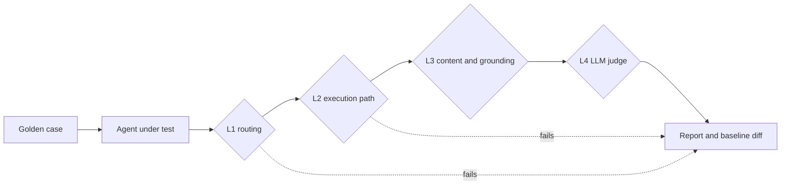

# agent-eval-harness

Layered, regression-first evaluation for LLM agents. Point it at your agent, give it a golden set, and it tells you **which layer broke** (routing, execution path, content, or answer quality), **what regressed against the last good run**, and **which graph nodes got slower**. It exits non-zero when quality drops, so it doubles as a CI gate on every merge request.

No dependencies outside the Python standard library. Works with LangGraph, LangChain, plain function calls, or an HTTP endpoint you wrap in a function.

## Why layered

Most LLM evals jump straight to "ask another LLM if the answer is good". That is slow, costly and noisy, and it hides the boring root cause. In production agents, most failures are structural: the classifier picked the wrong route, a guardrail node was skipped, the retriever never ran. Those are deterministic and cheap to check.



| Layer | Checks | Cost |
| --- | --- | --- |
| **L1 routing** | the classifier sent the question to the expected route | free, deterministic |
| **L2 execution path** | the graph walked the expected nodes in order, never touched forbidden ones (for example `retriever` on a legal question) | free, deterministic |
| **L3 content** | required and forbidden phrases, verbatim canned answers, grounding overlap with retrieved documents | free, deterministic |
| **L4 judge** | an LLM grades the answer against a rubric, with strict JSON parsing so a malformed reply fails instead of passing | one LLM call |

The judge is skipped when L1 or L2 already failed, which keeps reports readable and judge spend down.

## Quickstart

```bash
pip install -e ".[dev]"
pytest -q

cd examples
evalkit run --agent toy_agent:agent --dataset golden.jsonl --judge keyword --min-pass-rate 0.9
```

`examples/toy_agent.py` is a small rule-based agent shaped like a LangGraph RAG bot (classifier, retriever, answer node, canned legal answers, a prompt-injection guardrail), so everything runs without an API key.

## Golden set format

One JSON object per line. Every check is opt-in.

```json
{"id": "legal-001",
 "question": "If your saw injures me, are you liable?",
 "tags": ["canned", "safety"],
 "expect": {
   "route": "legal",
   "path_exact": ["classifier", "canned"],
   "canned": "I can't give legal advice. Please contact our legal team."
 }}
```

Available keys under `expect`: `route`, `path_contains`, `path_exact`, `path_excludes`, `must_mention`, `must_not_mention`, `canned`, `grounded`, `judge_rubric`. Unknown keys and duplicate ids are rejected at load time, because a typo in a golden set silently disables a test.

## Plugging in your agent

Return an `AgentResponse` from any callable:

```python
from evalkit import AgentResponse

def agent(question: str, context: dict) -> AgentResponse:
    state = graph.invoke({"question": question, **context})
    return AgentResponse(
        answer=state["answer"],
        route=state["category"],
        execution_path=state["execution_path"],
        documents=[d.page_content for d in state["documents"]],
        node_latency_s=state.get("timings"),
    )
```

For a real judge, set `EVALKIT_JUDGE_URL`, `EVALKIT_JUDGE_KEY` and `EVALKIT_JUDGE_MODEL` (any OpenAI-compatible chat endpoint) and pass `--judge openai`.

## Regression gate

Save a run from a known good build, then compare every new build against it:

```bash
evalkit run --agent my_bot:agent --dataset golden.jsonl --out baseline.json
# ...change a prompt, swap the model...
evalkit run --agent my_bot:agent --dataset golden.jsonl --baseline baseline.json --min-pass-rate 0.9
```

Example output after a prompt change broke the classifier for legal questions:

```text
**Pass rate:** 80.0% (8/10)

| First failing layer | Cases |
| --- | --- |
| L1 | 2 |

- `legal-001`: L1 route: expected 'legal', got 'knowledge'; L2 path_exact: got ['classifier', 'retriever', 'answer']
- `legal-002`: L1 route: expected 'legal', got 'knowledge'; L2 path_excludes:retriever: got [...]

Pass rate 100.0% -> 80.0%
- Regressions: legal-001, legal-002
- Route changes: legal-001, legal-002

FAIL: regressions against baseline: ['legal-001', 'legal-002']
```

When the agent reports per-node timings, the diff also lists every node that became at least 1.3x slower. That is how you catch a model migration that keeps answers correct but doubles latency in one node.

The included GitHub Actions workflow runs the tests on Python 3.10 and 3.12, then runs the golden set as a gate and writes the report to the job summary.

## Project layout

```
src/evalkit/
  dataset.py     golden set loading and validation
  assertions.py  L1 to L4 checks
  judge.py       OpenAI-compatible LLM judge and an offline keyword judge
  runner.py      runs cases (optionally in parallel) and aggregates results
  report.py      markdown report, baseline diff, latency percentiles, node slowdown
  cli.py         `evalkit run`, exit code for CI
examples/        toy agent and a 10-case golden set (knowledge, canned, adversarial, out of scope)
tests/           pytest suite
```

## Background

I built this from patterns I use day to day as a Quality AI Engineer on a production LangGraph assistant serving 60+ countries: golden sets per routing node, execution-path assertions as the primary QA signal, zero tolerance on canned legal answers, LLM-as-a-judge only on top, and per-node latency diffs for model migrations. This repository is an independent, generic implementation with its own example data.

## License

MIT
